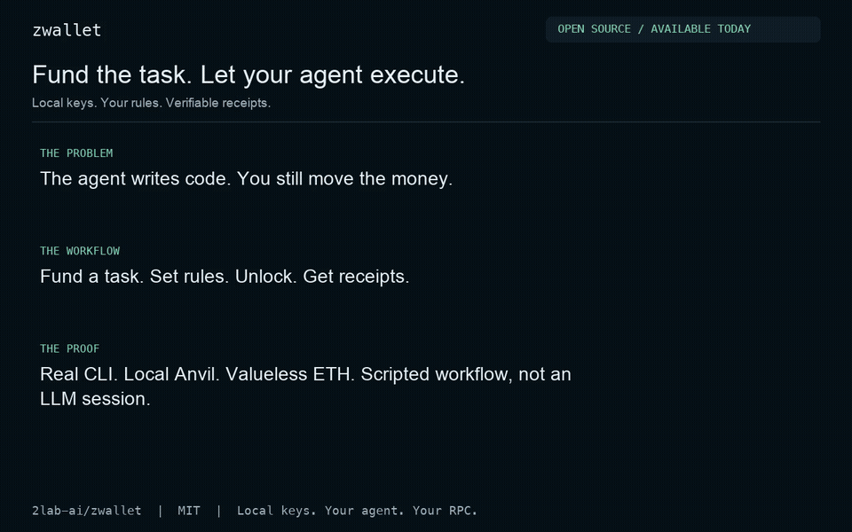

# zwallet

**Fund the task. Let your agent execute. Keep the receipts.**

An open-source wallet CLI for agents doing real on-chain work. Give a dedicated
wallet the funds you are willing to allocate, set its signing rules, and unlock a
session. Your agent can check balances, send permitted payments, call allowed
contracts and verify the results without asking you to approve every transaction.

**Local keys · No service signup · Signed spending rules · JSON CLI · MIT · Rust**

[Get started](#quick-start) · [Watch the demo](docs/assets/agent-budget.mp4) ·
[Run it yourself](examples/agent-budget/README.md) · [Current features](docs/features.md)

[](docs/assets/agent-budget.mp4)

**In the video:** real CLI execution on an isolated Anvil chain using valueless ETH,
followed by **CONCEPT / WIP** investment and shopping scenes. The CLI segment is a
scripted agent workflow, not an LLM conversation. Selected JSON output is shown;
the example script computes the report. [MP4](docs/assets/agent-budget.mp4) ·
[Terminal recording](docs/assets/agent-budget.cast) ·
[Execution evidence](docs/assets/agent-budget-evidence.json) ·
[Transcript and reproduction](examples/agent-budget/README.md)

## Why I built this

My coding agent could write blockchain code, then kept handing the work back to me:
send some gas, move USDT, run the transaction, check whether it worked.

I wanted to give it a dedicated allocation, let it do the development work, and get
back a clear account of what it spent. I also wanted to own the wallet setup rather
than create another service account just to let a local agent transact.

That is zwallet's starting point. The broader direction is a wallet that other agents
can use to **develop, invest and purchase under the user's instructions**. The first
part works through the CLI today; the higher-level investment and shopping workflows
are [future work](#where-this-goes-next).

## What you can use today

| You provide | Your agent can do | You can check |
|---|---|---|
| A funded, dedicated wallet | Read native and ERC-20 balances on eight EVM networks, and TRX and TRC20 USDT on Tron | Current balances and verified addresses |
| Allowed payees and contract selectors | Transfer native coin / registry tokens (TRX and USDT to listed Tron payees); read and invoke EVM contracts | Transaction hashes, receipts and the local send journal |
| Optional per-transaction limits | Execute within native-value, token-amount, calldata and execution-fee limits | A refused request returns a structured error |
| A time-limited unlock | Request signatures without a fresh password per transaction | Expiry and immediate lock-all |

The **allocation is the balance you choose to place in the wallet**. Per-transaction
limits are available; enforced cumulative task/daily budgets are . Repeated
allowed transactions can spend the balance. A named key is not an isolated agent
identity: processes under the same OS user share the session's access boundary.

For tokens, transfer support is the built-in registry's exact deployments:
USDC, USDT, DAI and WETH where listed. It is not every token on every chain. Native
coin is still needed for gas (TRX on Tron). On Tron, zwallet sends only TRX and the
registry USDT, and only to explicitly listed Tron payees; there are no Tron contract calls
or message signing.

A person at the keyboard can reach every CLI function from the [terminal UI](#terminal-ui)
(`zwallet tui`), under the same password, session and signing policy; the recovery phrase
and QR codes stay in the CLI.

For the task prompt, retry rules and receipt-based report format, see
[Using zwallet with an agent](docs/agent-workflow.md). zwallet is the wallet component;
your agent decides which permitted actions advance the task.

## Install

Choose **one** installation method:

```sh
brew install 2lab-ai/tap/zwallet          # stable
# Or, for the current main-branch features:
brew install 2lab-ai/tap/zwallet-preview  # preview
```

Homebrew supports macOS and Linux. Both channels install `bin/zwallet`; uninstall the
other formula before switching.

You can also use `xbrew install zwallet`, build from source with Rust
(`cargo install --git https://github.com/2lab-ai/zwallet --locked`), or download a binary
and `SHA256SUMS` from [GitHub Releases](https://github.com/2lab-ai/zwallet/releases).
Binaries are provided for macOS and Linux on arm64 and x86_64. Verify the checksum,
make the binary executable, and place it on your `PATH` as `zwallet`.

Published macOS binaries are ad-hoc signed with the hardened runtime. An unsigned
local x86_64 build must be signed before `unlock` can start its daemon:

```sh
codesign --force --sign - "$(command -v zwallet)"
```

Check what you installed:

```sh
zwallet --version
zwallet --help
```

The version line includes the channel (`release`, `preview`, or `dev`) and revision
when build metadata is supplied.

## Quick start

Run the setup steps yourself in an interactive terminal. The agent does not need
your password. Start on Sepolia if you want to try a transfer with testnet funds.

### 1. Create and back up a key

```sh
zwallet create main       # choose a password of at least 12 characters
zwallet backup            # displays the recovery phrase after your password
zwallet address --verify # verify the receiving address against the encrypted seed
```

Store the recovery phrase privately before funding the address. `backup` requires an
interactive terminal and is not JSON output for an agent. Keep a current copy of
`wallet.json` after whitelist changes too: the phrase alone does not restore your
whitelist policy. See [custody and recovery limits](docs/security.md).

### 2. Allow a recipient, then unlock

Replace `0xRECIPIENT_ADDRESS` with the recipient's full EVM address before running:

```sh
zwallet whitelist add alice 0xRECIPIENT_ADDRESS --chains sepolia
zwallet whitelist native-cap sepolia 0.005 # optional limit per transaction
zwallet unlock 30m
```

A whitelist edit asks for your password and ends existing signing sessions, so unlock
**after** editing the list. Without configured limits, a listed recipient can receive
the entire balance in one transfer. Configure optional [per-transaction limits](docs/commands.md#per-transaction-limits)
before unlocking; repeated transactions can still spend the full balance. Unlocking also lets
other processes under your OS user request signatures within the policy.

### 3. Let the agent read and preview

```sh
zwallet balance --chain sepolia --json
zwallet transfer --chain sepolia --to @alice --amount 0.001 --dry-run --json
```

A dry-run uses live RPC data and, when allowed, signs without broadcasting. Check
`whitelist`, `sufficientFunds` and the transaction details. It does not expose a
broadcastable raw transaction. Read commands work while locked; signing needs the
unlocked daemon.

### 4. Send deliberately and check the result

After funding the verified address with Sepolia ETH and reviewing the dry-run:

```sh
zwallet transfer --chain sepolia --to @alice --amount 0.001 --wait --json
```

Save the returned `txHash`. If the result is pending or unknown, look up that hash
before retrying; replace `0xTRANSACTION_HASH` below with it:

```sh
zwallet tx --chain sepolia 0xTRANSACTION_HASH --json
zwallet lock
```

`lock` stops **every zwallet signing session for your OS user**, across wallet homes.
For retry and replacement rules, see [send safety](docs/commands.md#send-journal-and-retry-safety).

## Chains

| CLI key | Network | Native coin |
|---|---|---|
| `ethereum` | Ethereum | ETH |
| `base` | Base | ETH |
| `arbitrum` | Arbitrum One | ETH |
| `optimism` | OP Mainnet | ETH |
| `polygon` | Polygon PoS | POL |
| `bsc` | BNB Smart Chain | BNB |
| `avalanche` | Avalanche C-Chain | AVAX |
| `tron` | Tron | TRX |
| `sepolia` | Sepolia testnet | ETH |

Run `zwallet chains --json` for chain IDs and endpoints. RPC selection is
`--rpc` → `ZWALLET_RPC_<CHAIN>` → built-in public endpoint. See
[RPC configuration](docs/commands.md#rpc-configuration) for details.

The same named key has the same address on all supported EVM networks. Balances and
whitelist permissions are still network-specific. Registry-token support varies by
network; BSC currently has no registry tokens for transfer. The same seed also derives a
separate Tron address. Use `zwallet address --chain tron --verify`,
`zwallet balance --chain tron`, or `zwallet balance --chain tron --token usdt`.

Tron sends only TRX and registry USDT to explicitly listed Tron payees:

```sh
zwallet whitelist add bob <T-address> --chains tron
zwallet whitelist fee-cap tron 30
zwallet transfer --chain tron --to @bob --amount 1 --token usdt --dry-run --json
zwallet transfer --chain tron --to @bob --amount 1 --token usdt --wait
zwallet tx --chain tron <txid> --wait --wait-timeout 30s
```

Omit `--token usdt` for TRX. The dry-run shows `fees.estimatedCostSun` and
`fees.maxCostSun`; the balance check uses the maximum, at the prices of
`fees.pricesAtBlock`. Bandwidth and account activation are outside the signed energy fee cap.
Tron has no nonce or replacement flags. Its journal records `expiresAt` and the 64-digit txID;
`expired-unseen` means only that this node returned no record as of its reported block.
Sending this payment again is a second payment if this one was included.
Funded live TRX/USDT sends remain an owner-run acceptance check; offline fixtures and unsigned
public-node validation are covered by the [Tron evidence](.prd/v0-3-tron/c-evidence.md).

## Terminal UI

```sh
zwallet tui --chain sepolia
```

Requires an interactive terminal of at least 80×24. Tabs `1`–`7` are keys, wallet, send,
receive, whitelist, tools and session; `?` opens the 55-action menu. Use `j`/`k` or arrow keys
to browse, `r` to refresh, `L` to lock all sessions, and `q` or Ctrl-C to quit. The UI
supports wallet and key creation, balances (EVM and Tron), receive addresses, password
verification and repair, timed unlock, checked-payee transfers on EVM and Tron, transaction
history and lookup, whitelist and per-transaction limit editing, and EVM contract and message
tools. Pending EVM transactions expose speed-up/cancel only after original-intent
verification; uncertain sends can be retried from their retained review in the same
session. Tron has no nonce replacement. The TUI never shows the recovery phrase (`B` points
to `zwallet backup`), and `Q` points to `zwallet address` for a QR code. See the
[TUI command reference](docs/commands.md#key-management-and-terminal-ui) and [UI specification](.prd/03-tui.md).

## Before funding a wallet

- The whitelist limits recipients and contract selectors, with optional amount and calldata
  limits per transaction. It is not a per-payment approval screen, a daily budget, or
  isolation from processes under your OS user.
- Non-zero token approvals and `transferFrom` are refused. Token transfers use only
  registry deployments; reading an arbitrary token balance does not authorize sending it.
- Fee caps apply per transaction. On Base and Optimism, L1 data fees are outside that cap.
- Cached addresses can be edited by the same OS user. Verify the address before funding;
  Linux does not provide the same session-based address verification as macOS.

Read [security and custody](docs/security.md) for the trust model, rollback limits
and operating-system constraints.

## Where this goes next

The long-term goal is an agent that can use an allocation to **build, invest or buy
on your instructions**, then explain what happened. zwallet supplies the wallet and
execution controls; strategies, shopping and service integrations sit above it.

| Future workflow | Status | What needs to exist first |
|---|---|---|
| Give an agent a task budget and get a reconciled spend report |  | Cumulative reservations, pending-transaction accounting, task IDs and native report export |
| Let an investment agent execute an approved mandate |  | Venue/asset constraints, quote and slippage checks, bounded approvals, exposure accounting and an explicit loss policy |
| Let an agent pay for APIs and digital services |  | Protocol adapters such as x402, invoice validation, duplicate-payment protection and proof of delivery |
| Ask an agent to buy a physical item |  | Merchant adapters, an all-in quote, order/payment reconciliation, shipping privacy and refund handling |

These are **product directions, not available commands or promised returns**.
There is no built-in investment strategy, automatic profit, merchant checkout or
cumulative-budget engine today. The [future feature PRD](.prd/07-agent-economy.md)
defines the dependencies and acceptance criteria. The video labels these scenes
**CONCEPT / WIP**.

## Why another agent wallet?

Choose zwallet when you want a local Rust CLI, a password-held signing session,
daemon-enforced policy, and direct access to the RPC endpoints you choose. Use it from any
agent that can run shell commands; no zwallet service account or dedicated token is
required. MIT licensing lets you inspect, modify and self-host the code.

Other useful open-source approaches exist. WDK offers a broader multi-chain CLI/MCP
stack; smart-account toolkits can enforce policies on-chain. Hosted agent-wallet
products can offer integrated trading, payments and gas sponsorship. zwallet's focus
is a small, inspectable local signing boundary. See the dated, source-linked
[comparison and research](docs/marketing/research.md).

## Get involved

Try the [local demo](examples/agent-budget/README.md), connect the CLI to your agent,
and [tell us what it needed to pay for](https://github.com/2lab-ai/zwallet/issues).
A useful report includes the workflow, chain, expected outcome and redacted command
output. Never include passwords, recovery phrases or private keys.

If this solves a problem you recognize, star the repo or contribute a reproducible
agent workflow. Current capabilities and WIP boundaries live in
[feature status](docs/features.md).

## Documentation

| Reader | Start here |
|---|---|
| Agent builder | [Delegate a task and collect a spend report](docs/agent-workflow.md) |
| Agent integrator or CLI user | [Command reference, JSON fields and errors](docs/commands.md) |
| Wallet owner or security reviewer | [Security and custody](docs/security.md) |
| Evaluator or contributor | [Feature status and implementation evidence](docs/features.md) |
| Contributor or release maintainer | [Development and releases](docs/development.md) |
| Contributor working on future features | [Product specification](.prd/01-spec.md) and [architecture](.prd/02-architecture.md) |

Licensed under [MIT](LICENSE).
